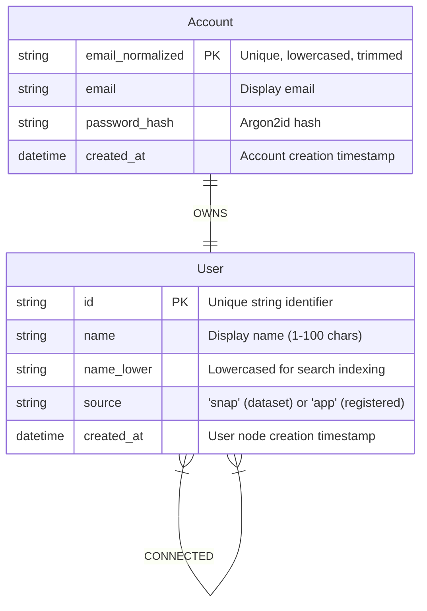

# Database & Data Model Guide

This guide details the Neo4j graph model, constraints, indexes, Cypher query patterns, and Redis caching schemas used throughout the system.

---

## 1. Neo4j Graph Model

The graph database separates public social graph nodes from private credential storage to eliminate credential leakage risks.



### 1.1 Node Labels & Properties

#### `(:User)`
Represents public persona and graph connectivity.
- `id` (`STRING`, **Unique**): Identifier used across all graph operations. For Stanford SNAP dataset nodes, IDs are numeric strings (`"0"` to `"4038"`). For web-registered accounts, IDs are 32-character hexadecimal UUIDs (`uuid4().hex`).
- `name` (`STRING`): Display name. Dataset users are seeded as `User_<id>` (e.g., `User_42`). Registered users supply their name on signup.
- `name_lower` (`STRING`): Case-folded copy of `name` utilized by text index search queries.
- `source` (`STRING`): Origin flag: `"snap"` for pre-ingested benchmark graph nodes, `"app"` for interactive user accounts.
- `created_at` (`DATETIME`): UTC timestamp when the node was merged.

#### `(:Account)`
Represents private authentication credentials. Strictly decoupled from the public graph.
- `email_normalized` (`STRING`, **Unique**): Trimmed, lowercased email string.
- `email` (`STRING`): Original formatted email address.
- `password_hash` (`STRING`): Argon2id password hash generated with pinned time/memory cost parameters.
- `created_at` (`DATETIME`): UTC timestamp of account registration.

### 1.2 Relationship Types

#### `(:Account)-[:OWNS]->(:User)`
Directed ownership relationship. Registration creates an `Account`, `User`, and `OWNS` relationship atomically in one write transaction. The schema does not enforce ownership cardinality; the unique constraints below apply only to node properties.

#### `(:User)-[:CONNECTED]->(:User)`
Represents an undirected friendship connection between two users.
- **Canonical Direction Rule:** Application writes store relationships from the lexicographically smaller ID to the larger ID (`lo < hi`). This convention alone does not guarantee duplicate prevention or race safety: Neo4j Community has no relationship uniqueness constraint, and the live concurrency check remains deferred.
- **Undirected Query Rule:** All traversal and path queries match undirected patterns: `(a:User)-[:CONNECTED]-(b:User)`.
- `created_at` (`DATETIME`): UTC timestamp when the connection was merged.

---

## 2. Schema Constraints & Indexes

Schema bootstrapping is idempotent and managed by `app/db/schema.py`:

```cypher
// Enforce unique node identity
CREATE CONSTRAINT user_id_unique IF NOT EXISTS
FOR (u:User) REQUIRE u.id IS UNIQUE;

// Enforce unique normalized email on credentials
CREATE CONSTRAINT account_email_unique IF NOT EXISTS
FOR (a:Account) REQUIRE a.email_normalized IS UNIQUE;

// Optimize partial-match name search
CREATE TEXT INDEX user_name_lower_text IF NOT EXISTS
FOR (u:User) ON (u.name_lower);
```

---

## 3. Core Cypher Query Shapes

All queries are executed with parameterized inputs inside explicit transactions (`execute_read` or `execute_write`) with configurable timeouts (`NEO4J_QUERY_TIMEOUT_SECONDS=5`).

### 3.1 Bounded Shortest Path
Depth limit is parameterized as a literal in Cypher (Neo4j requires literal depth bounds):

```cypher
MATCH (a:User {id: $start_id}), (b:User {id: $end_id})
MATCH p = shortestPath((a)-[:CONNECTED*..6]-(b))
RETURN [n IN nodes(p) | {id: n.id, name: n.name}] AS path
```

### 3.2 Friend Recommendations (Triadic Closure)
Finds friends-of-friends not currently connected to the user, ranked by mutual friend count:

```cypher
MATCH (u:User {id: $user_id})-[:CONNECTED]-(f:User)-[:CONNECTED]-(candidate:User)
WHERE candidate <> u AND NOT (u)-[:CONNECTED]-(candidate)
RETURN candidate.id AS id, candidate.name AS name, count(DISTINCT f) AS mutual_count
ORDER BY mutual_count DESC, id ASC
SKIP $skip LIMIT $limit
```

### 3.3 Canonical Friendship Creation
Computes `lo, hi = sorted([user_a, user_b])` in Python before invoking Cypher:

```cypher
MATCH (lo:User {id: $lo_id}), (hi:User {id: $hi_id})
MERGE (lo)-[r:CONNECTED]->(hi)
ON CREATE SET r.created_at = datetime()
RETURN count(r) AS matched
```

### 3.4 Canonical Friendship Removal
```cypher
MATCH (lo:User {id: $lo_id})-[r:CONNECTED]->(hi:User {id: $hi_id})
DELETE r
RETURN count(r) AS deleted_count
```

### 3.5 Name Search
Utilizes the text index on `name_lower`:

```cypher
MATCH (u:User)
WHERE u.name_lower CONTAINS $query_lower
RETURN u.id AS id, u.name AS name, u.source AS source
ORDER BY u.name_lower ASC, u.id ASC
SKIP $skip LIMIT $limit
```

---

## 4. Redis Caching & Rate Limiting Schema

Redis acts purely as a volatile cache and rate limiting store. Losing Redis state never corrupts or loses graph data.

| Key Pattern | Type | TTL | Purpose |
|---|---|---|---|
| `graph:version` | `STRING` (Integer) | No TTL (Redis remains volatile) | Global integer counter incremented whenever graph topology mutates. A Redis restart may reset it; this is safe because old path entries are lost with the cache. |
| `path:v{V}:{lo}:{hi}` | `STRING` (JSON) | 300 seconds (5 min) | Cached shortest path array stored in canonical `lo -> hi` direction. |
| `path:v{V}:{lo}:{hi}` (Negative) | `STRING` | 60 seconds (1 min) | Cached negative-path payload (`{"state": "not_found", "path": null}` via `CachedPathPayload`) indicating no reachable path within max depth. |
| `rate:login:ip:{ip}` | `STRING` (Integer) | 60 seconds | Atomic fixed-window rate limit counter (5 requests / min). |
| `rate:login:email:{ip}:{email_digest}` | `STRING` (Integer) | 60 seconds | Credential-stuffing protection counter (5 requests / min). `email_digest` is `sha256(normalized_email)`. |
| `rate:register:ip:{ip}` | `STRING` (Integer) | 60 seconds | Registration rate limit counter (5 requests / min). |
| `rate:search:ip:{ip}` | `STRING` (Integer) | 60 seconds | Name search query limit counter (30 requests / min). |

### 4.1 Global Version Invalidation Flow
1. Query reads current global version: `V = GET graph:version` (defaults to `0` via `int(raw_version or 0)`).
2. Keys are generated using endpoints sorted lexicographically: `lo, hi = sorted([start, end])`.
3. If hit, the path array is reversed if the caller requested `hi -> lo`.
4. After a committed edge addition, removal, or batch dataset ingestion, the application attempts `INCR graph:version`.
5. A successful bump makes previous versioned keys unreachable. If Redis is unavailable or the bump fails, stale entries may remain usable until their TTL expires.

---

## 5. Dataset Ingestion & Backup Operations

### 5.1 Dataset Pipeline (`app/cli.py ingest`)
- Downloads or reads local archive: `data/facebook_combined.txt.gz`.
- Validates SHA-256 digest (`125e84db872eeba443d270c70315c256b0af43a502fcfe51f50621166ad035d7`).
- Skips comments, empty lines, and filters out self-loops (`a == b`).
- Deduplicates edges within each batch.
- Batch inserts via `UNWIND $batch AS edge` with parameter chunk sizes of 2,000 edges.
- Reports exact created counts from Neo4j `ResultSummary.counters`.
- Increments `graph:version` upon completion.

### 5.2 Backup & Restore Procedures
- **Backup (`deploy/local/backup.sh`):** Executes offline database dump via `neo4j-admin database dump neo4j --to-path=/backups`.
- **Restore (`deploy/local/restore.sh <dump-file>`):** Prompts for confirmation, stops the API container, loads dump via `neo4j-admin database load neo4j --from-path=... --overwrite-destination=true`, and restarts services.
