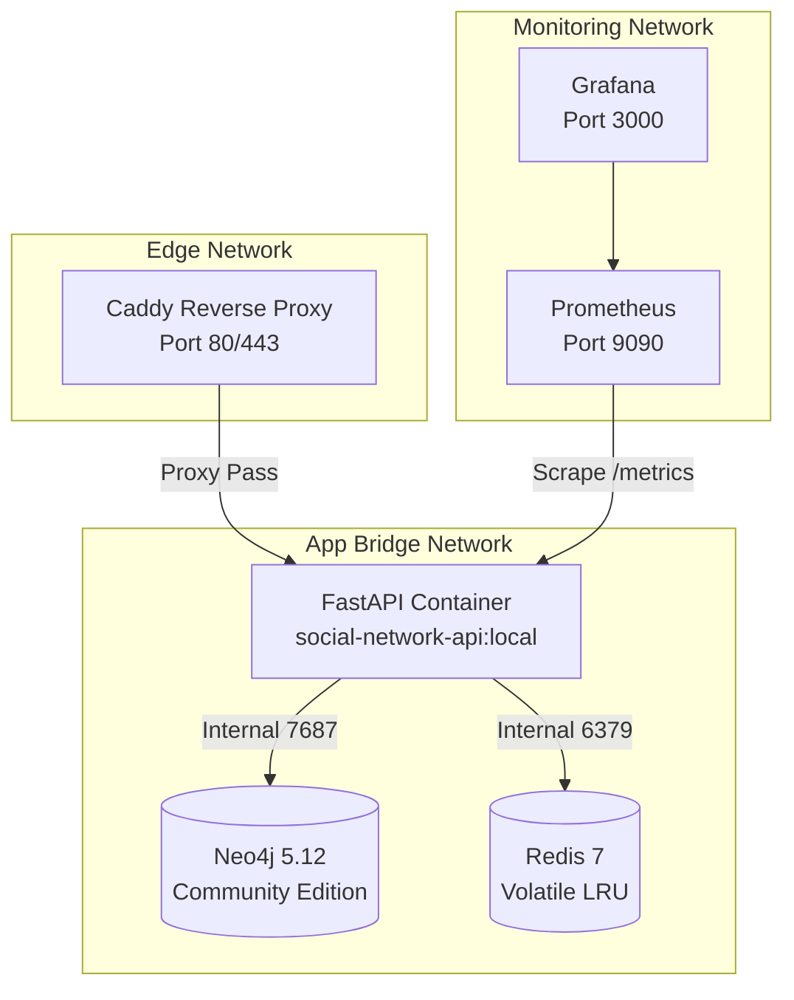

# Deployment & Operations Guide

This guide covers the container topology, production-like Compose configurations, local deployment and automated rollback scripts, offline backup/restore procedures, and operational recovery runbooks.

---

## 1. Container Topology & Compose Profiles

The stack is orchestrated using Docker Compose across three configuration profiles:



### 1.1 Compose File Breakdown

- **`docker-compose.yml` (Base):**
  Defines core services (`api`, `neo4j`, `redis`) on the isolated bridge network `social-network`. No database ports are published to host interfaces.
- **`docker-compose.override.yml` (Development):**
  Applied automatically during local `docker compose up`. Binds ports exclusively to `127.0.0.1` (`api`: 5000, `neo4j`: 7474/7687, `redis`: 6379) and enables volume bind-mounts for live code reloading.
- **`docker-compose.prod.yml` (Production-Like):**
  Enforces production boundaries:
  - Disables host port publishing for database and cache.
  - Adds `caddy` as the public entrypoint on `:80` and `:443` under the `edge` profile (`profiles: [edge]`; requires `--profile edge` or `COMPOSE_PROFILES=edge` to activate).
  - Disables API documentation (`ENABLE_DOCS=false`).
  - Routes traffic through a dedicated `edge` subnet (`172.29.0.0/24`).

---

## 2. Environment & Secrets Management

Production-like deployments use an uncommitted, host-isolated `.env` file configured with strict Unix permissions:

```bash
# On the production host:
cp .env.example .env
chmod 600 .env
```

### Essential Production Variables

| Variable | Recommended Production Setting | Description |
|---|---|---|
| `APP_ENV` | `prod` | Enforces production error handling and security headers. |
| `ENABLE_DOCS` | `false` | Disables `/docs` and `/openapi.json` from public inspection. |
| `SECRET_KEY` | *(Random 32-byte hex)* | JWT signing key. Must not contain sample or placeholder text. |
| `NEO4J_PASSWORD` | *(Random 24-byte hex)* | Password for internal Neo4j database user. |
| `REDIS_PASSWORD` | *(Random 24-byte hex)* | Password required for Redis client authentication. |
| `WEB_CONCURRENCY` | `2` (default) | Number of Uvicorn worker processes per API container. |
| `TRUSTED_PROXY_ADDRESSES` | `172.29.0.0/24` | IP range of the Caddy reverse proxy permitted for forwarded headers. |

---

## 3. Local Deployment & Automated Rollback

The script `deploy/local/deploy.sh` deploys the local stack and attempts automatic recovery if the new API fails its readiness check. It does not provide zero-downtime upgrades:

```bash
bash deploy/local/deploy.sh
```

### How the Rollback Mechanism Operates:
1. **Pre-Deployment Tagging:** Identifies the currently running API container, inspects its image SHA, and tags it with a unique rollback marker: `social-network-api:rollback-<pid>-<timestamp>`.
2. **Container Rebuild:** Builds the updated API image first via `docker compose build api` (if build fails, the running stack is untouched and deployment halts). On build success, starts the stack via `docker compose up --detach --no-build`.
3. **Readiness Probing:** Polls `http://127.0.0.1:5000/health/ready` (checking database connectivity and Redis availability) up to 30 attempts at 2-second intervals.
4. **Automatic Rollback:** If the health probe fails or times out:
   - Restores the previous image tag.
   - Restarts the container with the original image.
   - Verifies the rolled-back container returns healthy.
   - Exits non-zero with diagnostic logs.

---

## 4. Backup & Disaster Recovery

Neo4j Community Edition requires offline database locks for physical dumps. The system provides atomic backup and confirmation-gated restore scripts.

### 4.1 Creating a Database Backup
```bash
bash deploy/local/backup.sh [output_directory]
```
- Gracefully stops `api` and `neo4j` to prevent concurrent write transactions.
- Executes `neo4j-admin database dump neo4j` via a disposable helper container writing to a dedicated backup volume.
- Copies the resulting `.dump` archive to the host directory (default: `./backups/neo4j-<timestamp>.dump`).
- Automatically cleans up staging volumes and brings the services back online.

### 4.2 Restoring from Backup
Restoring overwrites existing graph data and requires explicit typed confirmation to prevent accidental loss:

```bash
bash deploy/local/restore.sh backups/neo4j-20261104T000000Z-1234.dump
```
- Prompts: `This replaces the Neo4j database. Type RESTORE <dump-name> to continue:`
- Validates the confirmation string.
- Stops `api` and `neo4j`.
- Mounts the dump archive read-only into `/restore` and executes:
  `neo4j-admin database load neo4j --from-path=/restore --overwrite-destination=true`
- Restarts `neo4j` and `api` and reports successful completion.

---

## 5. Operations & Troubleshooting Runbooks

### 5.1 Service Health Probing
```bash
# Basic process liveness:
curl -f http://127.0.0.1:5000/health

# Comprehensive dependency readiness:
curl -f http://127.0.0.1:5000/health/ready
```
`GET /health/ready` returns HTTP 200 with `{"status": "ok", "components": {"neo4j": "ok", "redis": "ok"}}`. If Neo4j is disconnected, it returns HTTP 503 `UNAVAILABLE`.

### 5.2 Common Failure Modes & Resolution

| Symptom | Cause | Remediation Runbook |
|---|---|---|
| **API fails on startup** | Missing or placeholder secret in `.env`. | Verify `SECRET_KEY`, `NEO4J_PASSWORD`, and `REDIS_PASSWORD` are populated and do not contain sample substrings. |
| **503 on path queries** | Neo4j query timeout exceeded (>5s) or database down. | Check `docker compose logs neo4j`. Verify memory allocation (`NEO4J_HEAP_MAX`). |
| **Slow path query response** | Redis cache missed or Redis service unreachable. | Verify Redis connectivity via `docker compose exec redis redis-cli -a "$REDIS_PASSWORD" ping`. |
| **429 on login/search** | Fixed-window rate limit threshold reached. | Wait for the 60-second window to expire; inspect `Retry-After` response header. |

---

## 6. Operational Limitations

- **Single Host Scope:** The Compose configurations are designed for a single physical or virtual host. Multi-region replication, distributed database clustering, and high-availability failover groups are out of scope.
- **Offline Backup Window:** Because Neo4j Community does not support online live dumps, running `backup.sh` or `restore.sh` causes a brief planned downtime (approx. 5-15 seconds) while the database engine is paused.
- **Verification Status:** Behavioral tests for deployment and backup scripts are authored but unverified because the available Windows Bash launcher could not run them. Live Docker deployment and backup/restore behavior are also unverified because Docker engine access was unavailable.
